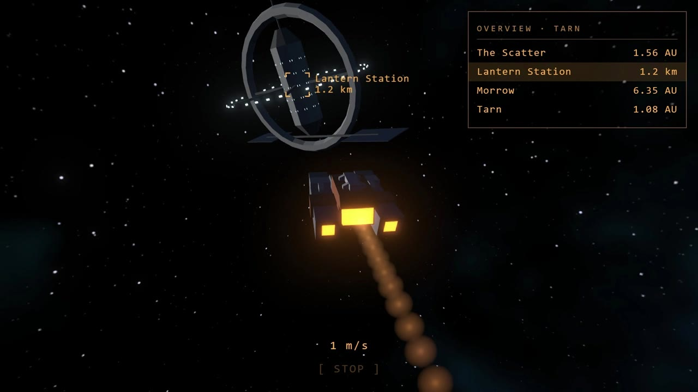

# Space Demo

A small solo tech demo: one Ship, alone in a star system, in the spirit of EVE Online. It is meant to feel cold and empty, and at the same time cozy and exciting.

[](https://youtu.be/4mlIAYnFjA0)

*Watch the 27-second teaser on [YouTube](https://youtu.be/4mlIAYnFjA0).*

Built with the official [`@pixi/3d`](https://pixijs.com/) package on PixiJS 8. There is no combat, no score and no goal. You fly, you look, you Warp.

## What is in it

- **One System, four places.** Tarn has an asteroid field (The Scatter), Lantern Station, the gas giant Morrow, and the star Tarn itself. Each is its own Grid with its own light.
- **Three Commands, and only three.** Heading, Stop and Warp.
- **Warp.** The Ship aligns, enters a tunnel of streaks, and arrives at rest with the destination dead ahead.
- **Contacts.** Now and then an "Unknown" shows up on the Overview and leaves again. It never answers.
- **Sound.** A reactor hum that follows your speed, a rising Warp tone, soft ticks, and a quiet ambient pad.

## Run it

You need Node.js and a browser with WebGPU or WebGL2.

```bash
npm install
```

```bash
npm run dev
```

Then open http://localhost:5173 and click to begin.

The Demo prefers WebGPU and falls back to WebGL2. Add `?renderer=webgl` to the address to force WebGL2.

## How to fly

| You want to | Do this |
| --- | --- |
| Look around | Drag to orbit the Ship, scroll to zoom |
| Fly somewhere | Double-click in space to set a Heading |
| Stop | Click `[ STOP ]` |
| Pick a destination | Click its row in the Overview, or click the object in space |
| Warp | Select a destination more than 50 km away, then click `[ WARP TO … ]` |

Leave the controls alone for 20 seconds and the camera starts a slow orbit on its own.

## Other scripts

| Script | What it does |
| --- | --- |
| `npm test` | Runs the Simulation tests with Vitest |
| `npm run build` | Type-checks, then builds to `dist/` |
| `npm run preview` | Serves the built Demo |

## How it is put together

All the rules live in one pure module, the **Simulation** ([src/simulation.ts](src/simulation.ts)). It knows nothing about rendering or sound, and it is the only part with tests. The scene, the HUD and the audio read its state and never write it.

| File | Job |
| --- | --- |
| [src/simulation.ts](src/simulation.ts) | Ship motion, the three Commands, Warp phases, Contacts |
| [src/system.ts](src/system.ts) | The System's Celestials, and distance formatting |
| [src/main.ts](src/main.ts) | The scene: Ship, Grid, Warp tunnel, engine trail, camera |
| [src/hud.ts](src/hud.ts) | Overview, selection bracket, speed readout, buttons |
| [src/audio.ts](src/audio.ts) | Synthesised hum, Warp sound and ticks, plus the ambient pad |
| [src/backdrop.ts](src/backdrop.ts) | The star field and nebula, generated in code |
| [src/grids.ts](src/grids.ts), [src/asteroids.ts](src/asteroids.ts) | The station, gas giant, star and asteroid field |

The Ship never moves. It stays at the origin and the Grid moves the other way, which keeps the numbers small at large distances. The reasoning is in [ADR 0001](docs/adr/0001-ship-stays-at-origin.md).

The words used here (Ship, Grid, Celestial, Contact, Overview and the rest) are defined in [GLOSSARY.md](GLOSSARY.md).

## Credits

- Ship model from the Kenney Space Kit (CC0).
- Ambient track "Outer Space Loop" by wipics, from OpenGameArt (CC0).

Details are in [public/assets/SOURCES.txt](public/assets/SOURCES.txt). Everything else in the scene, including the station, the planets, the sky and the other sounds, is made in code.
